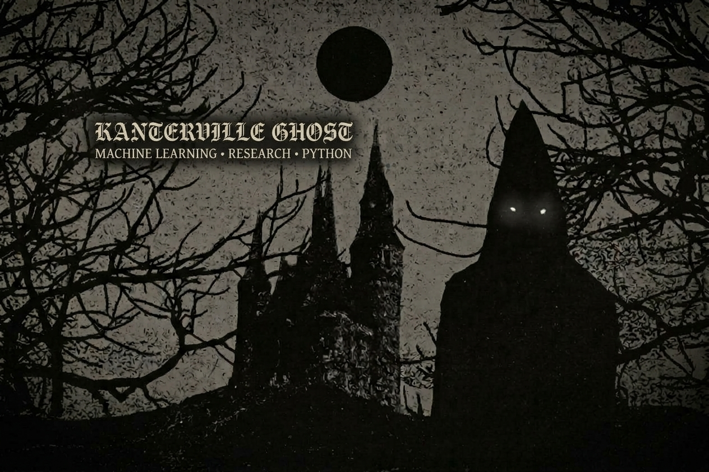

  

 

  ☾ &nbsp; MACHINE LEARNING &nbsp; · &nbsp; RESEARCH &nbsp; · &nbsp; PYTHON &nbsp; ☾
  
   
  
  
  
  
  
  

 

---

 

<!-- ═══════════════ ABOUT ═══════════════ -->

  <h3><i>between mathematics & machines</i></h3>

  
CS student at <b>Beijing Institute of Technology</b>. I research how models learn when data is scarce, focusing on <b>small-sample learning</b>, <b>conformal prediction</b>, and <b>reinforcement learning</b>.

  
  
I build open-source libraries that bridge the gap between theoretical guarantees and practical implementations — from robust gradient boosting to calibrated neural networks.

 

---

 

<!-- ═══════════════ PROJECTS ═══════════════ -->

  <h3><i>Selected Works</i></h3>

 

> **Ⅰ. Small Data Machine Learning (Paper)**
> *The Trilemma of Low-Sample Tabular Regimes*
> 
> The theoretical foundation of Small Data. Formalizes the "Trilemma of Small Data" (variance, bias, and uncertainty under validation depletion) and evaluates the exact scaling boundaries where standard models fail.
> 
> 
> 
> 

 

> **Ⅱ. SmallGBM**
> *Robust gradient boosting for tabular data (n < 1000)*
> 
> Replaces fragile mean-based second-order Taylor approximations with robust median leaf estimation. Built with a native C core (256-bin histograms) for 2-3x faster training.
> 
> `Outperforms XGBoost and LightGBM on 22 small datasets`
> `Limits AUC degradation to 3.7x less than XGBoost under 20% label corruption`
> 
> 
> 
> 
> 

 

> **Ⅲ. SmallMLP**
> *Adaptive neural networks with calibrated conformal intervals (n < 500)*
> 
> Eliminates manual architecture search by deriving layer width and dropout directly from dataset geometry. Produces prediction intervals with finite-sample coverage guarantees.
> 
> `Best mean rank among 10 models on 18 datasets (zero-tuning)`
> `Produces 19% narrower intervals than split conformal at equal coverage`
> 
> 
> 
> 
> 

 

> **Ⅳ. RL-from-scratch**
> *Value-based reinforcement learning*
> 
> Implementing algorithms from first principles to understand the mechanics behind agents, rather than treating them as black boxes.
> 
> `DQN` | `Double DQN` | `Dueling DQN`
> 
> 

 

---

 

<!-- ═══════════════ TECH STACK ═══════════════ -->

  <h3><i>Arsenal</i></h3>
   
  

 

---

 

<!-- ═══════════════ STATS ═══════════════ -->
<!-- 

  

 -->

  
   
  ☾ &nbsp; BEIJING · CHINA · 2026 &nbsp; ☾

