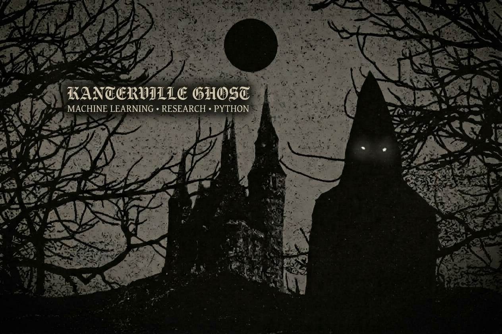

  

 

  ☾ &nbsp; MACHINE LEARNING &nbsp; · &nbsp; RESEARCH &nbsp; · &nbsp; PYTHON &nbsp; ☾
  
    
  
  
  
  
  

  

  

 

<!-- ═══════════════ ABOUT ═══════════════ -->

  <h3><i>between mathematics & machines</i></h3>

  
CS student at <b>Beijing Institute of Technology</b>. I research how models learn when data is scarce, focusing on <b>small-sample learning</b>, <b>conformal prediction</b>, and <b>reinforcement learning</b>.

  
  
I build open-source libraries that bridge the gap between theoretical guarantees and practical implementations — from robust gradient boosting to calibrated neural networks. When I'm not writing code, I'm reading papers or solving integrals.

  

  

 

<!-- ═══════════════ PROJECTS ═══════════════ -->

  <h3><i>Selected Works</i></h3>

 

> **Ⅰ. SmallGBM**
> *Gradient boosting for small datasets*
> 
> A gradient boosting implementation focused on tabular learning when data is scarce. Native C core, robust leaf regularization.
> 
> `ROC-AUC: 0.9101` | `22 datasets` | `PyPI`
> 
> [→ Source](https://github.com/nsdmlk/SmallGBM) · [→ Paper (Zenodo)](https://doi.org/10.5281/zenodo.21934674)

 

> **Ⅱ. SmallMLP**
> *Non-parametric regression & conformal sets*
> 
> Adaptive MLP that replaces manual architecture search with dataset-derived hyperparameters, producing calibrated prediction intervals.
> 
> `25/45 wins` | `31/32 wins (width)` | `PyPI`
> 
> [→ Source](https://github.com/nsdmlk/SmallMLP) · [→ Preprint (in prep)](https://github.com/nsdmlk/SmallMLP)

 

> **Ⅲ. RL-from-scratch**
> *Value-based reinforcement learning*
> 
> Implementing algorithms from first principles to understand the mechanics behind agents, rather than treating them as black boxes.
> 
> `DQN` | `Double DQN` | `Dueling DQN`
> 
> [→ Source](https://github.com/nsdmlk/RL-from-scratch)

  

  

 

<!-- ═══════════════ TECH STACK ═══════════════ -->

  <h3><i>Arsenal</i></h3>
   
  

  

  

 

<!-- ═══════════════ STATS ═══════════════ -->

  

 

  
   
  ☾ &nbsp; BEIJING · CHINA · 2026 &nbsp; ☾

